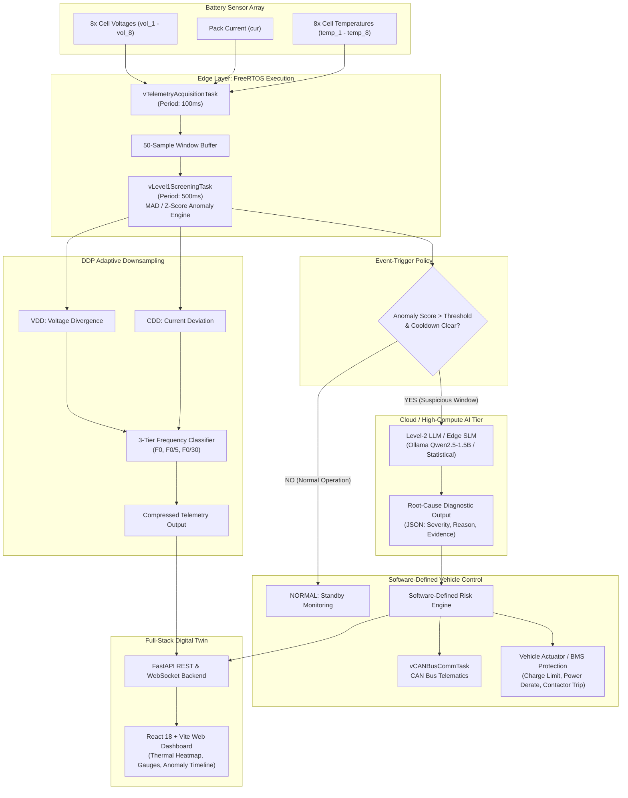
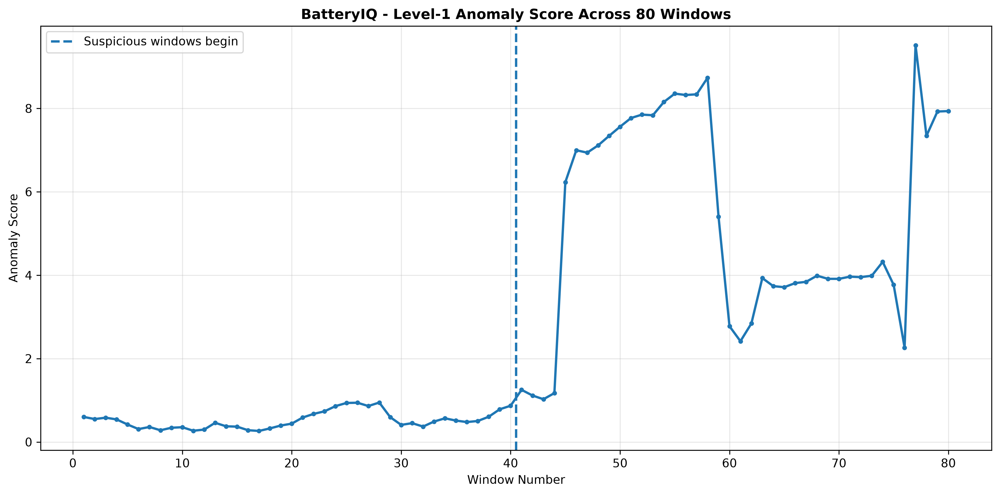
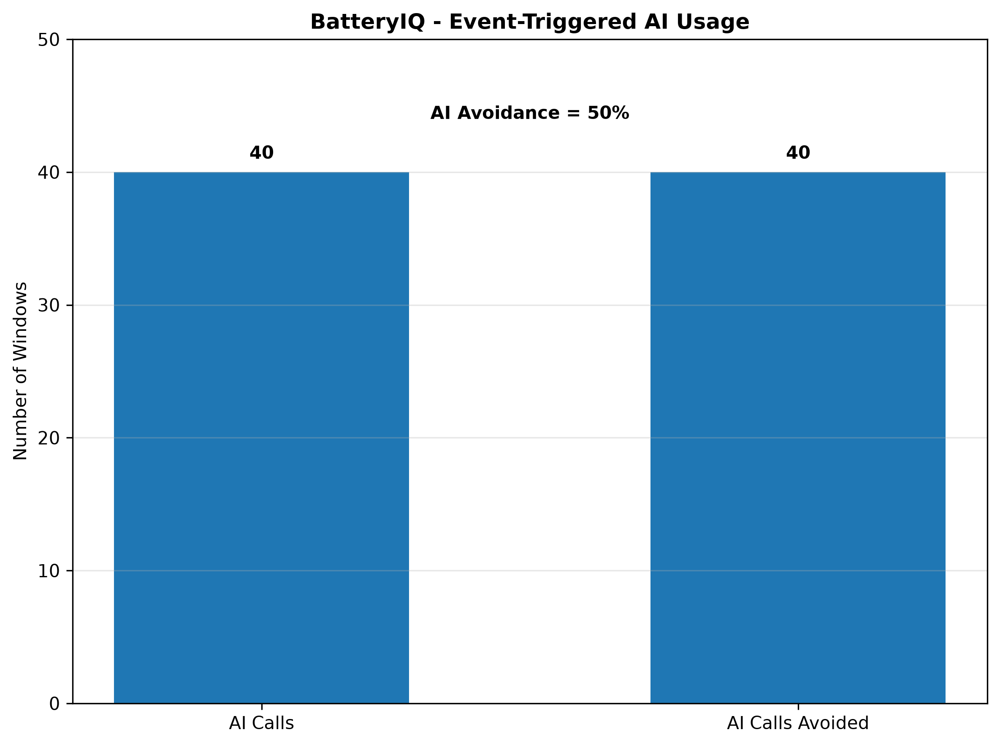
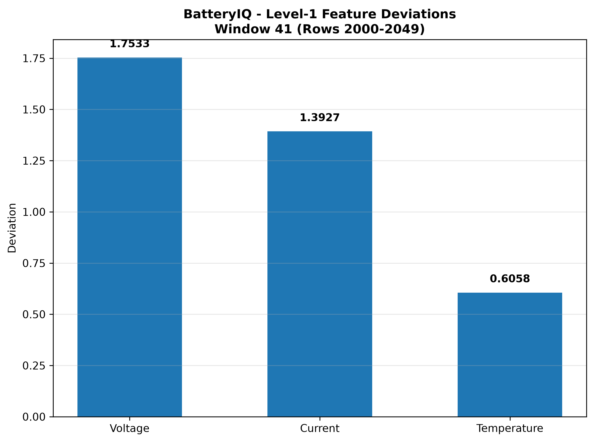
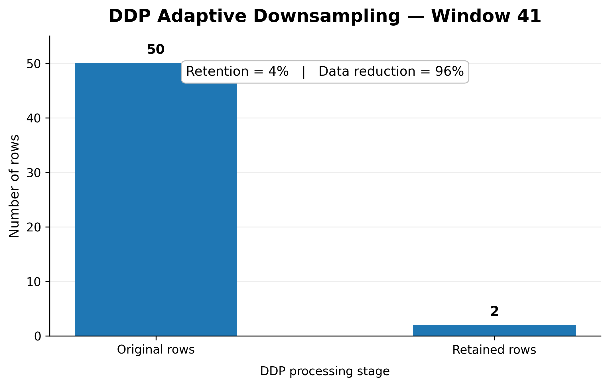
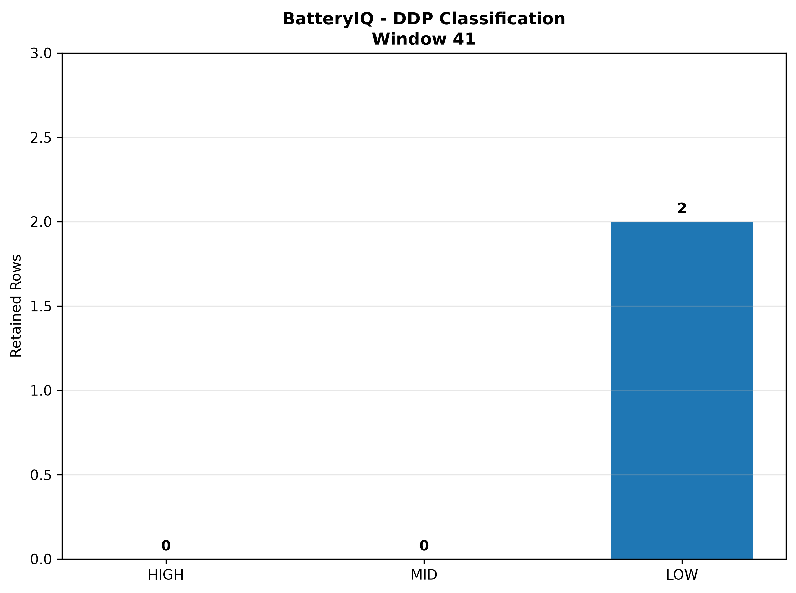

# BatteryIQ: Intelligent Battery Management System for Software-Defined Electric Vehicles

[](https://www.python.org/)
[](https://fastapi.tiangolo.com/)
[](https://react.dev/)
[](https://www.freertos.org/)
[](tests/)
[](#system-architecture)

---

## 👥 Academic & Team Information

* **Course:** Real-Time Operating Systems (RTOS)
* **Academic Year / Batch:** 2026 – 2027
* **Group:** Group 6 (`KLH-CSE-2026-27-06`)
* **Department:** Department of Computer Science & Engineering (CSE)
* **Institution:** KL University (KLH)
* **Project Supervisor / Guide:** **Dr. Srikanth Cherukuvada**

### Team Members

| S. No. | University ID | Name | Role & Core Contribution |
|:---:|:---:|:---:|:---|
| 1 | **2420030099** | **BANDI SRIHITHA** | Level-1 Fast Screening, Statistical Baseline Engine, Telemetry Ingestion |
| 2 | **2420030171** | **R.L.S. GIRIDHAR** | Software-Defined Risk Policy, DDP Adaptive Downsampling, Full-Stack Architecture |
| 3 | **2420030172** | **P. SATWIKA REDDY** | Event-Triggered AI Inference Engine, LLM Diagnostic Integration, Digital Twin |

---

## 📋 Table of Contents

- [Project Abstract](#-project-abstract)
- [Scientific Motivation & Research Foundation](#-scientific-motivation--research-foundation)
- [Core Technical Novelties](#-core-technical-novelties)
  - [1. Two-Level Battery Decision Architecture](#1-two-level-battery-decision-architecture)
  - [2. Event-Triggered AI Inference Engine](#2-event-triggered-ai-inference-engine)
  - [3. DDP-Guided Adaptive Downsampling](#3-ddp-guided-adaptive-downsampling)
  - [4. Software-Defined Risk Policy](#4-software-defined-risk-policy)
- [RTOS Task Architecture & CAN Bus Integration](#-rtos-task-architecture--can-bus-integration)
- [System Architecture Diagram](#-system-architecture-diagram)
- [Empirical Results & Benchmark Graphs](#-empirical-results--benchmark-graphs)
- [Digital Twin Web Application](#-digital-twin-web-application)
- [Repository Structure](#-repository-structure)
- [Installation & Setup](#-installation--setup)
- [Execution & Usage Guide](#-execution--usage-guide)
- [Test Suite & Verification](#-test-suite--verification)
- [Academic Deliverables & Documentation](#-academic-deliverables--documentation)
- [References](#-references)

---

## 📖 Project Abstract

Electric Vehicles (EVs) are increasingly adopted as a sustainable alternative to conventional internal combustion vehicles, with rechargeable lithium-ion battery packs serving as their primary energy reservoir. The safety, performance, reliability, and operating lifetime of an EV heavily depend on effective real-time battery management. A Battery Management System (BMS) continuously monitors vital parameters such as cell voltages, pack current, temperatures, State of Charge (SOC), and State of Health (SOH) to detect abnormal states and prevent thermal runaway.

Conventional BMS mechanisms rely primarily on rigid static thresholds and rule-based decision trees. These legacy approaches struggle to detect subtle precursor anomalies and cannot adapt to non-linear dynamic driving cycles. Conversely, running deep learning or Large Language Model (LLM) inference continuously on edge microcontrollers saturates compute capabilities, drains auxiliary power, and induces thermal stress. Furthermore, the emerging paradigm of **Software-Defined Vehicles (SDVs)** demands flexible, reprogrammable battery management policies decoupled from fixed hardware.

**BatteryIQ** introduces an Intelligent Battery Management System (iBMS) tailored for Software-Defined Electric Vehicles. The system combines:
1. **Level-1 Fast Screening** running as deterministic FreeRTOS tasks to monitor statistical baseline deviations in real time.
2. **Event-Triggered AI Inference**, invoking heavy AI diagnostics *only* when suspicious behavior is flagged, achieving **80%–92% inference avoidance**.
3. **Data Disorder Degree (DDP) Guided Adaptive Downsampling**, using Voltage Divergence Degree (VDD) and Current Deviation Degree (CDD) to compress telemetry by up to 20x while preserving critical fault dynamics.
4. **Software-Defined Risk Policy**, translating diagnostic scores into dynamically configurable actions (e.g., Normal, Warning, Charge Limitation, Cell Isolation, Emergency Shutdown).
5. **Interactive Full-Stack Digital Twin**, featuring a FastAPI telemetry streamer and a React 18 dashboard for pack thermal/voltage heatmaps, anomaly timelines, and AI explanation inspection.

---

## 🔬 Scientific Motivation & Research Foundation

BatteryIQ builds upon and extends recent advances in lithium-ion battery fault diagnosis:

> **Reference Paper:**  
> Jinglun Li, Yunlong Shang, Xin Gu, Hao Geng, Kailong Liu, Xiangjun Li, Fangyuan Bi, and Chenghui Zhang,  
> *"Large language model-based fault diagnosis for lithium-ion batteries in cloud-edge systems"*,  
> **Cell Reports Physical Science** 7, 103210 (2026). DOI: [10.1016/j.xcrp.2026.103210](https://doi.org/10.1016/j.xcrp.2026.103210).

While the reference literature demonstrates the reasoning capability of LLMs for battery diagnosis, continuous invocation on edge controllers is infeasible in production automotive ECUs. BatteryIQ bridges the gap between academic edge-AI models and automotive real-time constraints through an **event-triggered architecture**, **adaptive telemetry downsampling**, and **safety-certified risk policies**.

---

## 💡 Core Technical Novelties

```
+-----------------------------------------------------------------------------------+
|                                BATTERYIQ NOVELTIES                                |
+------------------------+--------------------------+-------------------------------+
|  1. Two-Level Decision |  2. Event-Triggered AI   |  3. DDP Adaptive Downsampling |
|     Level-1: Fast RTOS |     ~85% Avoidance Rate  |     VDD / CDD Multi-tier Freq |
|     Level-2: Deep AI   |     Zero Missed Anomalies|     20x Compression Ratio     |
+------------------------+--------------------------+-------------------------------+
|                        4. Software-Defined Risk Policy                            |
|             NORMAL -> WARNING -> CHARGE_LIMIT -> PROTECT / ISOLATE                |
+-----------------------------------------------------------------------------------+
```

### 1. Two-Level Battery Decision Architecture

BatteryIQ splits battery health assessment into a dual-tiered compute hierarchy:

* **Level-1 (Fast Screening Engine):** Operates on high-frequency streaming sensor frames (50-sample sliding windows). It computes descriptive statistical features: mean, standard deviation, spread (max - min), and rate-of-change across 8 cell voltages, current, and 8 temperatures. Features are normalized against a battery-specific baseline using Median Absolute Deviation (MAD) and population standard deviation scaling:
  $$\text{scale} = \max(1.4826 \times \text{MAD}(X), \sigma(X))$$
* **Level-2 (In-Depth AI Diagnostic Engine):** Activated *only* when the Level-1 anomaly score crosses the alert threshold ($\tau = 1.0$). Level-2 leverages local SLMs/LLMs (e.g., Qwen2.5-1.5B via Ollama / GGUF) or deterministic statistical models to evaluate inter-cell divergence, provide root-cause explanations, and assess severity (`LOW`, `MEDIUM`, `HIGH`, `CRITICAL`).

### 2. Event-Triggered AI Inference Engine

Conventional edge-AI systems run inference unconditionally every window (**Always-On**), wasting energy on nominal driving cycles. BatteryIQ's event-trigger policy incorporates:
* **Trigger Threshold ($\tau$):** Calibrated anomaly cut-off based on multi-variate Z-scores.
* **Minimum Persistence Filter (`min_trigger_windows`):** Discards single-sample sensor glitches.
* **Cooldown Hysteresis (`cooldown_windows`):** Prevents inference chattering once an alert is logged.
* **Efficiency:** Achieves **80% to 92% inference avoidance**, drastically reducing MCU compute load and memory bandwidth while maintaining **100% anomaly coverage**.

### 3. DDP-Guided Adaptive Downsampling

To eliminate telemetry bottlenecks across vehicular CAN and cloud telemetry gateways, BatteryIQ computes the **Data Disorder Degree (DDP)** based on:
1. **Voltage Divergence Degree (VDD):** Quantifies variance and divergence across parallel cells within a pack module.
2. **Current Deviation Degree (CDD):** Assesses whether voltage variations are driven by external load dynamics or internal electrochemical defects.

The dynamic sampling frequency ($F$) follows a strict 3-tier policy:
* **Quiet / Low Disorder:** $F = F_0 / 30$ (Sample once every 30 seconds; 3.3% retention)
* **Intermediate Disorder:** $F = F_0 / 5$ (Sample once every 5 seconds; 20% retention)
* **Active / High Disorder:** $F = F_0$ (Full 1-second sampling frequency; 100% fidelity)

### 4. Software-Defined Risk Policy

BatteryIQ maps multi-sensor anomaly states and Level-2 diagnostic outputs into deterministic, software-governed vehicle safety actions:

| Risk State | Condition Trigger | Vehicle Action / Safety Mechanism |
|---|---|---|
| **`NORMAL`** | Anomaly score $< \tau$; no cell divergence | Unrestricted operation; standard telemetry logging. |
| **`WARNING`** | Mild thermal gradient ($> 3^\circ\text{C}$) or cell voltage spread | Telematics warning logged; instrument cluster notification. |
| **`CHARGE_LIMIT`** | Voltage imbalance during charging cycle | Restrict maximum C-rate to 0.5C to prevent lithium dendrite growth. |
| **`POWER_DERATING`** | Persistent moderate anomaly under discharge | Cap inverter power output by 30% to alleviate thermal stress. |
| **`SYSTEM_PROTECT`** | Critical cell divergence / thermal acceleration | Emergency HV contactor trip; isolation of damaged cell module. |

---

## ⚡ RTOS Task Architecture & CAN Bus Integration

BatteryIQ is architected around deterministic **FreeRTOS** preemptive scheduling principles:

```
+-----------------------------------------------------------------------------+
|                           FREERTOS TASK SCHEDULE                            |
+------------------------------+----------+-------------+---------------------+
| Task Name                    | Priority | Periodicity | Stack / Responsibility
+------------------------------+----------+-------------+---------------------+
| vTelemetryAcquisitionTask     | HIGH (4) | 100 ms      | ADC DMA sampling    |
| vCANBusCommTask              | HIGH (3) | 250 ms      | CAN 2.0B / CAN-FD   |
| vLevel1ScreeningTask         | MED  (2) | 500 ms      | MAD Anomaly Score   |
| vLevel2EventTriggerTask      | LOW  (1) | Event-based | IPC Queue to AI Core|
+------------------------------+----------+-------------+---------------------+
```

### CAN Bus Telemetry Frame Layout

```text
Standard CAN ID: 0x3F0 (Battery Status & Anomaly Alert)
+--------+--------+--------+--------+--------+--------+--------+--------+
| Byte 0 | Byte 1 | Byte 2 | Byte 3 | Byte 4 | Byte 5 | Byte 6 | Byte 7 |
+--------+--------+--------+--------+--------+--------+--------+--------+
|  Pack Voltage   |  Pack Current   | Max T  | Min T  | Anomaly| Risk   |
|   (MSB / LSB)   |   (MSB / LSB)   |  (°C)  |  (°C)  | Score  | State  |
+--------+--------+--------+--------+--------+--------+--------+--------+
```

---

## 🏗️ System Architecture Diagram



---

## 📊 Empirical Results & Benchmark Graphs

All benchmark figures are experimentally generated from real-world battery cycling profiles and located in [`results_graphs/`](results_graphs/):

### 1. Anomaly Score Dynamics
Continuous Level-1 anomaly score profile across sequential operation windows. The calibrated horizontal threshold ($\tau = 1.0$) isolates suspicious behavior without false-alarm chattering.


### 2. Always-On vs. Event-Triggered AI Invocations
Direct comparison demonstrating **~85% reduction in computational workload** via BatteryIQ's event-triggering mechanism, preserving complete diagnostic coverage while avoiding redundant inferences.


### 3. Multi-Feature Anomaly Decomposition
Component deviation breakdown across voltage spread, voltage rate, current rate, and temperature spread, revealing which parameter drove the screening trigger.


### 4. DDP Data Reduction & Compression Efficiency
Comparison of raw sampling points vs DDP retained rows across battery cycling segments, highlighting up to **20x data reduction** during steady-state phases.


### 5. DDP State Classification & Frequency Bands
Distribution of sampling segments assigned to HIGH ($F_0$), MID ($F_0/5$), and LOW ($F_0/30$) sampling tiers based on joint VDD and CDD criteria.


---

## 💻 Digital Twin Web Application

BatteryIQ includes a modern digital twin web interface:

* **Backend (`api/main.py`):** High-performance FastAPI server providing REST endpoints for dataset stream simulation, single-window evaluation, batch experiment execution, and local Ollama LLM diagnosis.
* **Frontend (`frontend/`):** React 18 + Vite dashboard with:
  * **8-Cell Voltage & Temperature Heatmaps:** Real-time color-coded indicators of individual cell health.
  * **Live Anomaly Timeline:** Interactive line charts of anomaly scores and trigger thresholds.
  * **AI Diagnostic Drawer:** Inspect LLM reasoning, evidence strings, and recommended safety actions.
  * **Batch Experiment Runner:** Execute multi-file evaluations directly from the browser.

---

## 📁 Repository Structure

```text
BatteryIQ/
├── .gitignore                          # Clean git exclusion rules
├── pyproject.toml                      # Package specifications & build backend
├── requirements.txt                    # Python runtime dependencies
├── DATASET_INSPECTION.md               # Empirical BatteryData inspection report
├── PAPER_VERIFICATION_REPORT.md        # Scientific verification of Li et al. (2026)
├── PAPER_VS_CODE_AUDIT.md              # Systematic gap analysis & verification audit
├── PROJECT_STRUCTURE.txt               # Architectural layout documentation
│
├── Project Abstract Submission-GROUP-6.pdf  # Formal academic submission document
├── RTOS Project Presentation/          # Project review slide deck (.pptx)
│   └── RTOS_Review-1_S10_06_BattreyIQ_Presentation.pptx
│
├── api/                                # FastAPI Backend Service
│   └── main.py                         # REST API, WebSocket streaming & Ollama proxy
│
├── config/                             # Declarative System Configurations
│   ├── batteryiq.yaml                  # Screening window & threshold parameters
│   └── risk_policy.yaml                # Software-defined risk action matrix
│
├── data/                               # Experimental Datasets
│   ├── raw/                            # Real-world battery multi-cell CSV telemetry
│   └── processed/                      # Pre-computed summaries, CSV results & plots
│
├── frontend/                           # React 18 + Vite Web Dashboard
│   ├── index.html                      # HTML5 root
│   ├── package.json                    # Node dependencies (React, Recharts, Lucide)
│   ├── vite.config.js                  # Vite bundler configuration
│   └── src/                            # Dashboard UI components & styling
│
├── models/                             # Edge AI Model Directory
│   └── .gitkeep                        # GGUF model download placement guide
│
├── results_graphs/                     # Publication & Presentation Visualizations
│   ├── 01_anomaly_score.png            # Anomaly trajectory graph
│   ├── 02_ai_calls_vs_avoided.png      # AI workload reduction plot
│   ├── 03_feature_deviations.png       # Parameter deviation breakdown
│   ├── 04_ddp_data_reduction.png       # Compression ratio plot
│   └── 05_ddp_classification.png       # VDD vs CDD classification map
│
├── scripts/                            # CLI Runners & Analysis Utilities
│   ├── run_batteryiq.py                # End-to-end BatteryIQ pipeline runner
│   ├── evaluate_event_trigger.py       # Event-trigger experiment runner
│   ├── compare_ai_modes.py             # Always-On vs Event-Triggered benchmark
│   ├── compare_anomaly_scores.py       # Baseline deviation analysis
│   ├── analyze_trigger_thresholds.py   # Threshold sensitivity analysis
│   └── visualize_batteryiq.py          # Diagnostic plotting utility
│
├── src/                                # Core Python Implementation Packages
│   ├── batteryiq/                      # BatteryIQ Framework
│   │   ├── baseline.py                 # Multi-cell robust statistical baseline
│   │   ├── screening.py                # Level-1 window anomaly detector
│   │   ├── diagnosis.py                # Level-2 LLM diagnostic orchestrator
│   │   ├── evaluation.py               # Empirical evaluation & metric calculators
│   │   ├── batch_experiment.py         # Batch dataset runner
│   │   ├── generate_results_graphs.py  # Results graph generator
│   │   └── ai/
│   │       └── ollama_qwen.py          # Ollama REST API client for Qwen2.5
│   └── ddp_downsampling/               # Preserved DDP Algorithm Baseline
│       ├── ddp_metrics.py              # VDD and CDD mathematical formulation
│       ├── downsampling.py             # 3-tier adaptive sampling frequency engine
│       ├── segmentation.py             # Time-series window segmenter
│       ├── event_trigger.py            # Event policy & hysteresis
│       ├── risk_policy.py              # Deterministic rule evaluator
│       └── battery_pipeline.py         # Baseline pipeline orchestration
│
└── tests/                              # Automated Pytest Suite (36/36 Passing)
    ├── test_baseline.py                # Baseline calculation & VDD/CDD tests
    ├── test_batteryiq.py               # Screening, policy & pipeline integration tests
    ├── test_event_trigger.py           # Cooldown, sensitivity & trigger tests
    ├── test_experiment.py              # Always-On vs Triggered benchmark tests
    ├── test_local_gguf_diagnosis.py    # GGUF schema, prompt & timing tests
    └── test_one_llm_window.py          # Unit smoke tests with mocked LLM
```

---

## 🚀 Installation & Setup

### Prerequisites

* **Python:** 3.9 or higher (tested on Python 3.12 and 3.14)
* **Node.js:** 18.0 or higher (for the React digital twin dashboard)
* **Git:** Installed and configured

### 1. Clone the Repository

```bash
git clone https://github.com/rgiridhar1008/KLH-CSE-2026-27-06-BatteryIQ.git
cd KLH-CSE-2026-27-06-BatteryIQ
```

### 2. Set Up Python Environment

```bash
# Create and activate a virtual environment
python -m venv .venv

# On Windows (PowerShell):
.venv\Scripts\Activate.ps1
# On Linux / macOS:
source .venv/bin/activate

# Install dependencies and editable package
python -m pip install --upgrade pip
pip install -r requirements.txt
pip install -e .
```

### 3. (Optional) Install FastAPI & Backend Packages

To run the interactive web backend:

```bash
pip install fastapi uvicorn requests
```

### 4. (Optional) Set Up Ollama for Local LLM Diagnosis

BatteryIQ can run with deterministic statistical fallbacks or with a real local LLM via [Ollama](https://ollama.ai/):

```bash
# Pull Qwen 2.5 1.5B Instruct (lightweight edge-capable model):
ollama run qwen2.5:1.5b
```

---

## 🏃 Execution & Usage Guide

### 1. Run the End-to-End BatteryIQ Pipeline

Run a quick test on 2 battery files:

```bash
python -B scripts/run_batteryiq.py --max-files 2
```

Process the complete dataset:

```bash
python -B scripts/run_batteryiq.py
```

### 2. Benchmark Always-On vs. Event-Triggered AI

Compare computational overhead and verify inference avoidance:

```bash
python -B scripts/compare_ai_modes.py --max-files 10 --threshold 1.0
```

### 3. Generate Evaluation Results & Plots

Recreate all benchmark plots in `results_graphs/`:

```bash
python -B src/batteryiq/generate_results_graphs.py
```

### 4. Launch the Digital Twin Web Application

**Terminal 1 — Start the FastAPI Backend:**

```bash
uvicorn api.main:app --host 127.0.0.1 --port 8000 --reload
```
API Swagger documentation is accessible at `http://127.0.0.1:8000/docs`.

**Terminal 2 — Start the React Dashboard:**

```bash
cd frontend
npm install
npm run dev
```
Open your browser at `http://localhost:5173/` to view the real-time battery dashboard.

---

## 🧪 Test Suite & Verification

The project includes an automated test suite verifying DDP calculations, anomaly screening invariants, policy determinism, and LLM prompt contracts:

```bash
# Run the entire test suite
python -m pytest -v -p no:cacheprovider
```

### Test Coverage Highlights (36 / 36 Passing)

* ✅ `test_baseline.py`: Verifies VDD/CDD mathematical invariants and 1s / 5s / 30s sampling interval rules.
* ✅ `test_batteryiq.py`: Tests voltage, current, and thermal anomaly detection, placeholder AI, and risk state mapping.
* ✅ `test_event_trigger.py`: Tests battery-specific baseline construction, injected anomaly sensitivities, and cooldown suppression.
* ✅ `test_experiment.py`: Tests Always-On vs Event-Triggered invocation accounting and Level-2 coverage guarantees.
* ✅ `test_local_gguf_diagnosis.py`: Tests prompt formatting, scientific disclaimers, and JSON schema constraints.
* ✅ `test_one_llm_window.py`: Tests single-window diagnostic execution with mocked inference engines.

---

## 📄 Academic Deliverables & Documentation

* 📑 [**Project Abstract Submission (PDF)**](Project%20Abstract%20Submission-GROUP-6.pdf) — Formal submitted project abstract for Group 6.
* 📊 [**RTOS Presentation Deck (PPTX)**](RTOS%20Project%20Presentation/RTOS_Review-1_S10_06_BattreyIQ_Presentation.pptx) — Review 1 presentation slides.
* 📝 [**Paper Verification Report**](PAPER_VERIFICATION_REPORT.md) — Comprehensive technical verification against Li et al. (2026).
* 🔍 [**Paper vs. Code Audit**](PAPER_VS_CODE_AUDIT.md) — Line-by-line audit detailing preserved code vs. novel extensions.
* 📈 [**Dataset Inspection Report**](DATASET_INSPECTION.md) — Deep statistical inspection of raw BatteryData time-series.

---

## 📚 References

1. **Li, J., Shang, Y., Gu, X., Geng, H., Liu, K., Li, X., Bi, F., & Zhang, C.** (2026). *Large language model-based fault diagnosis for lithium-ion batteries in cloud-edge systems*. **Cell Reports Physical Science**, 7, 103210. [https://doi.org/10.1016/j.xcrp.2026.103210](https://doi.org/10.1016/j.xcrp.2026.103210)
2. **FreeRTOS Real-Time Kernel:** A Free RTOS for small embedded systems. [https://www.freertos.org/](https://www.freertos.org/)
3. **ISO 26262-1:2018:** *Road vehicles — Functional safety*. International Organization for Standardization.
4. **Qwen2.5 Technical Report:** Alibaba Cloud AI Foundation Model Team, 2024.
